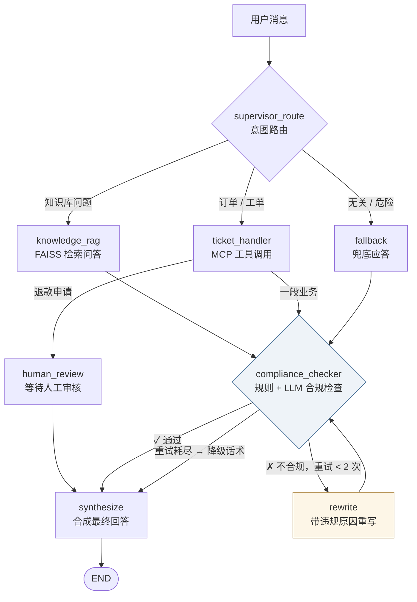

<div align="center">

# Agents on Duty

_一个能转人工、继续处理售后申请的 LangGraph 客服 Agent_

[](https://www.python.org)
[](https://langchain-ai.github.io/langgraph/)
[](https://react.dev)
[](https://docs.docker.com/compose/)

[快速开始](#-快速开始) · [看运行过程](#-一条消息如何流转) · [架构](#-系统架构) · [设计决策](#-设计决策-faq) · [测试](#-测试)

**简体中文** | [English](README.en.md)

</div>

---

## 📖 项目介绍

Agents on Duty 是一个可运行的客服 Agent 学习项目。它可以回答知识库问题、查询演示订单并受理退款申请；遇到需要人工判断的售后请求时，流程会暂停，交给客服审核，再根据审核结果继续处理。

用户可以查看订单和申请状态；客服可以在工作台查看交接信息、要求补充资料、批准或拒绝申请。项目适合想了解 Agent 编排、人工接管和故障恢复的开发者。

> **演示边界：**订单和退款使用模拟数据，审核通过不代表已执行退款；知识库、合规规则和权限机制仍需要完善，不可直接用于生产。

> [!TIP]
> **想深挖这个项目？** 完整版介绍在 [docs/project-intro.zh.md](docs/project-intro.zh.md)：
> 一条消息的 8 步完整旅程（带代码位置）· 技术选型对照表 · **面试官视角的 22 个问题与答题要点** · 三分钟开场话术。
> 可以从问题跳到相应代码，核查设计取舍。

## 🎯 已实现的能力

- **售后申请** —— 用户查看自己的演示订单、提交或撤回退款申请；重复请求通过幂等键处理。
- **人工客服工作台** —— 客服查看申请、会话和工具结果，批准、拒绝或要求用户补充信息。
- **暂停与恢复** —— 聊天中的退款申请进入人工审核；决定落库后恢复对应流程，恢复失败可在工作台重试。
- **知识库问答** —— 基于本地文档生成回答，展示检索到的来源和片段；模拟政策按发布状态和版本管理。

- **业务编排与合规** —— Supervisor 分流请求，生成的业务回答经过规则和模型检查，未通过时重写或使用兜底话术。
- **工具与故障处理** —— MCP 调用失败时可使用本地备用工具；对话与工作上下文支持存储降级。
- **身份与可观测性** —— 账号、角色和会话归属校验；SSE 展示处理进度，运维面板展示 Agent 指标。

## 🚀 快速开始

> [!TIP]
> 需要 Docker、一个 OpenAI 兼容的聊天模型，以及一个 embedding 服务——配置 `DASHSCOPE_API_KEY` 走阿里云原生接口，或留空复用 `OPENAI_BASE_URL` 走任何 OpenAI 兼容接口。首次启动会为 `knowledge_base/` 中的文本生成向量索引。

Embedding 服务故障时，知识库问答会提示暂不可用。启动时索引更新失败会保留原索引但暂停知识检索；服务恢复后需重启以重试建库。`/health` 展示最近一次观察到的知识库状态，并非对所有依赖的实时探测。

```bash
# 1. 配置环境变量
git clone https://github.com/Keviniscool-boy/agents-on-duty.git
cd agents-on-duty
cp .env.example .env
#    编辑 .env，至少填写：
#    OPENAI_API_KEY / OPENAI_BASE_URL / MODEL_NAME
#    EMBEDDING 服务凭据（DASHSCOPE_API_KEY 或 OPENAI_BASE_URL）、
#    MYSQL_PASSWORD、JWT_SECRET_KEY
#    若 8080 已被占用，把 FRONTEND_PORT 改成 8081

# 2. 一键启动
docker compose up --build -d

# 3. 浏览器打开 http://localhost:8080（或设置的 FRONTEND_PORT）
#    注册账号后开始对话或查看演示订单
```

### 体验人工接管

1. 注册并登录账号，打开「订单售后」查看演示订单。
2. 在终端执行 `docker compose exec app python -m auth.bootstrap_admin <用户名>`，再刷新页面，即可使用客服工作台。
3. 在聊天中申请退款，或从「订单售后」提交申请；到「客服工作台」审核、要求补充信息或拒绝。

聊天中创建的申请会暂停 Agent 流程；售后页面直接创建的申请没有关联聊天线程。两者均为演示，不会产生真实退款。角色设置与故障恢复说明见 [售后业务说明](docs/after-sales.md)。

## 🛠️ 后续方向

继续完善管理员运营与审计、知识库的版本和权限、真实业务系统接入，并评估 Pi 知识助手实验。具体计划见 [优化路线图](docs/optimization-roadmap.md)。

## 🔎 一条消息如何流转

试试这三个问题，观察界面显示的 Agent 节点：

| 你问 | 谁来接 | 你会看到 |
|---|---|---|
| 「商品签收后几天内可以退货？」 | 📚 知识库 RAG | FAISS 检索 → 合规通过 |
| 「查询我的订单」 | 🎫 业务办理 | MCP 工具调用 → 合规检查 |
| 「写一段小说」 | 💬 兜底应答 | 进入兜底节点 |

订单和退款申请使用按账户隔离的演示数据。询问「查询我的订单」可获取演示订单号；符合演示规则的订单可提交退款申请，申请仅进入待审核状态，不会执行真实退款。

演示规则：普通商品无理由退货须在签收后 7 天内申请；质量问题不套用该期限，进入人工审核。商品分类、时间或申请类型无法确认时也转人工。同一订单的待审核申请会防止重复创建；撤回后可以重新申请。接口与恢复细节见 [售后业务说明](docs/after-sales.md)。

<details>
<summary><b>不用 Docker，手动部署</b></summary>

```bash
# 后端（Python 3.12+，需要本机 MySQL 与 Redis）
pip install -r requirements-dev.txt
uvicorn api.main:app --port 8000

# 前端
cd frontend && npm install && npm run dev   # http://localhost:5173
```

环境变量名见 [`.env.example`](.env.example)。本机还需启动 MySQL；Redis 不可达时可降级，但会增加访问 MySQL 的压力。
</details>

## 🏗️ 系统架构



## 🧠 三层记忆与降级

> [!NOTE]
> 对话、工作上下文和知识库是三种不同的记忆。下表也列出与它们配合的持久化数据。

| 数据 | 第一选择 | 兜底 | 寿命 |
|---|---|---|---|
| 对话历史 | Redis（30 min TTL） | MySQL → 进程内 | 短期 |
| 路由 / 合规上下文 | Redis（24 h TTL） | MySQL → 进程内 | 会话级 |
| 用户账户、会话归属 | SQLite | — | 永久 |
| LangGraph 断点 | AsyncSqliteSaver | 启动失败 | 持久化不可用时拒绝启动 |
| 工单幂等记录 | SQLite | — | 永久 |
| 演示订单 / 退款申请 | SQLite | — | 按账户隔离；持久化演示数据 |

- MySQL 是兜底数据源 → **硬依赖**，启动自检失败直接拒绝启动
- Redis 是热缓存 → 运行中不可达时尝试 MySQL，再退进程内；内存兜底不跨进程或重启
- 所有落 MySQL 的上下文都带 `user_id` / `session_id`，可审计

#### 并发与多副本（A6/A7，已支持）

- **MySQL 路径原子合并**：上下文更新经 `merge_working_context` 在事务 + `SELECT ... FOR UPDATE` 行锁内完成，多 worker 并发写同一会话的不同字段不丢更新（含 gap-lock 死锁退避重试，`storage/mysql_store.py`）。
- **进程内副本仍按进程隔离**：它只是读取回退链的最后一环，一致性以 Redis/MySQL 层为准。
- **部署建议**：多 worker 部署配置 Redis 以共享缓存与登录限流计数；当前 compose 默认单 worker。
- 登录限流的 Redis 计数与进程内兜底计数互不相通，Redis 恢复后进程内计数视为清零。

## 🗂️ 项目结构

```
agents/          5 个 Agent + rewrite 重写节点
api/             FastAPI：同步 chat、SSE 流式、JWT 鉴权、工具与指标
memory/          short_term（对话）/ working_memory（路由状态）/ long_term（FAISS）
storage/         MySQL 兜底存储层
mcp_client/      MCP 客户端：重试 + 本地降级
mcp_tools/       MCP Server：订单、退款申请和工单等演示工具
tools/           本地备用工具 + 工单幂等存储
auth/            JWT + SQLite 用户库
tracing/         OpenTelemetry + Agent 指标
frontend/        React + Vite：会话管理、实时进度、轨迹标签、运维面板
evaluation/      8 个端到端评测脚本 + locust 压测
```

## ❓ 设计决策 FAQ

<details open>
<summary><b>工单幂等键为什么用内容指纹，而不是请求 ID？</b></summary>
<br>
请求 ID 每次工具调用都变——防得住网络重试，防不住"用户再说一遍"。内容指纹让重复提交直接返回原单号，对客服场景这本来就是更好的体验。代价是同内容工单只收一次，这是有意取舍。
<br><br><code>agents/ticket_handler.py → build_idempotency_key</code>
</details>

<details>
<summary><b>为什么 MySQL 是启动硬依赖，Redis 却允许挂？</b></summary>
<br>
启动时 `self_check` 要求 MySQL 可用。运行中 Redis 读写失败会尝试 MySQL；若 MySQL 此时也失败，部分上下文暂存在进程内，重启后会丢失。
<br><br><code>storage/mysql_store.py → self_check</code>
</details>

<details>
<summary><b>LangGraph 的 checkpointer 为什么必须用 AsyncSqliteSaver？</b></summary>
<br>
一个真实的坑：所有 API 走 <code>ainvoke</code>/<code>astream</code>，同步的 SqliteSaver 不支持 async 方法——图能编译，第一次聊天就 <code>NotImplementedError</code>。教训：<b>图能 compile ≠ 能跑</b>，切 checkpointer 后必须用图级测试真正执行（见 <code>test_compliance_loop.py</code>）。
</details>

<details>
<summary><b>演示订单数据存在哪里？</b></summary>
<br>
当前使用按账户隔离的 SQLite 演示订单和退款申请，不连接真实订单或支付系统。接入真实系统时需要以外部业务系统为事实源。
</details>

<details>
<summary><b>流式为什么选 SSE 而不是 WebSocket？</b></summary>
<br>
客服对话以服务端单向推送为主。SSE 基于普通 HTTP、自动重连，而 <code>graph.astream(stream_mode="updates")</code> 天然就是事件生成器，两者严丝合缝。
</details>

<details>
<summary><b>合规检查为什么"规则先行，LLM 补充"？</b></summary>
<br>
正则检查可在本地快速识别常见 PII 和固定敏感词；命中时短路 LLM 审查。它可能误伤普通长数字，也无法覆盖所有表达，规则未命中时再交给 LLM 做语义检查。
<br><br><code>agents/compliance_checker.py → full_check</code>
</details>

## ✅ 测试

```bash
pip install -r requirements-dev.txt
DASHSCOPE_API_KEY=dummy-key-for-ci python -m pytest -q
```

自动化测试覆盖退款规则与幂等、人工接管与恢复、权限隔离、合规回路和知识库降级。图级测试使用假模型，不调用真实 LLM 或执行真实退款。

| 关注点 | 主要测试文件 |
|---|---|
| 退款规则、账户隔离、幂等 | `test_after_sales.py` |
| 人工接管、恢复、权限、并发 | `test_human_in_the_loop.py` |
| 知识库 Embedding 降级 | `test_embedding_degradation.py` |
| 合规检查与重写 | `test_compliance_loop.py` |

> [!NOTE]
> MySQL 不可达时，依赖真实 MySQL 的用例会显式跳过；CI 使用独立 MySQL 服务运行这些用例。运行聊天和首次建索引需要有效的模型服务配置。

<details>
<summary><b>端到端评测</b></summary>

`evaluation/` 下 8 个脚本对着运行中的服务实测：路由准确率、RAG 质量、合规拦截、
MCP 弹性、记忆一致性、鉴权安全，以及 locust 压测。用法见各脚本头部注释。
</details>

## 🛠️ 技术栈

| 层 | 技术 |
|---|---|
| 编排 | LangGraph · LangChain |
| 服务 | FastAPI · Uvicorn · SSE |
| 工具协议 | MCP (Model Context Protocol) |
| 存储 | MySQL 8 · Redis · SQLite · FAISS |
| 前端 | React 19 · Vite · 原生 SSE |
| 可观测 | OpenTelemetry · 自研 Agent 指标 |
| 质量 | Pytest · GitHub Actions · Locust |
| 部署 | Docker Compose · Nginx |

## 📈 真实评测记录

开发过程中对每个子系统做过参数化调优并留有[完整评测日报](docs/test-record.md)（2026-09-11），关键数字：

| 子系统 | 调优动作 | 调优前 | 调优后 |
|---|---|---|---|
| 意图路由 | 新增 `fallback` 意图，兜底条件写入路由提示词 | 66.67%（8/12） | **100%**（12/12），均延迟 24.59s/条 |
| RAG 检索 | 检索阈值 0.6 → 0.55；RAG 来源传入合规检查；补高置信度本地路由 | — | 命中率 **92%**，回答正确率 **80%**（25 样本） |
| 合规检查 | 补 PII/承诺类规则；RAG 上下文传入 LLM 审查 | — | 规则 **6/6**，API 链路 **8/8** |
| MCP 工具链 | 修复评测脚本导入路径 | — | **7/7**（验证协议与调用链，非数据准确性） |
| 三层记忆 | — | — | **7/7**。注意：当时只验证了降级与恢复过程"不崩溃"，未断言故障期数据在恢复后仍可见、Redis 也不会自动回切——这两点（数据可见性/回切）直到 2026-10-26 修复后才由回归用例真正覆盖 |
| 鉴权与会话 | 注册/重复注册/错误凭证/跨用户会话隔离 | — | **9/9** |

> [!NOTE]
> 这些是**开发期自建样本集**上的结果，样本量小（12–25 条），用于验证设计方向而非声称生产级准确率——评测脚本与样本集在 [evaluation/](evaluation/) 可复跑。订单数据为 mock，MCP 结果代表链路正确而非业务数据准确。

## 📄 License

[MIT](LICENSE) © 2026
